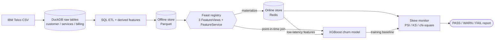

# Feature Store with Lineage — Telco Churn (Capstone Topic 12)

**Track:** Big Data Systems & Responsible AI Engineering · **Dataset:** IBM Telco Customer Churn (7,043 customers, public)
**Team:** Team member details omitted

A telecom churn model suffers from training-serving skew and nobody knows where features come from. This repo builds a
**Feast feature store** (offline Parquet/DuckDB + online Redis), records **lineage** from every feature back to its source
table/column with owners and sensitive-attribute tags, and **detects skew** with PSI, KS and chi-square tests plus schema checks.

## Architecture

Full lineage graph + dictionary: [`docs/lineage.md`](docs/lineage.md).

## Quick start
```bash
docker compose up --build          # redis -> ingest -> materialize -> train/serve -> skew -> lineage -> tests; then Jupyter
# Jupyter:  http://localhost:8889/?token=capstone   (notebooks/results.ipynb)
docker compose --profile ui up     # optional Feast UI at http://localhost:8890 (registry & lineage browser)
```
No Docker? `python -m venv .venv && . .venv/bin/activate && pip install -r requirements.txt && make local`
(SQLite online store; for the Redis benchmark start a local Redis and run `FEAST_ONLINE=redis REDIS_CONNECTION=localhost:6379 make bench`).

## Repository layout
```
docker-compose.yml  Dockerfile  requirements.txt  Makefile
common.py              paths, constants, Feast store factory (Redis in Docker / SQLite locally)
feature_store/         feature_store.yaml (Feast CLI config) + features.py (Entity, FeatureViews, FeatureService)
ingest_data.py         download IBM CSV -> DuckDB raw tables -> ETL -> Parquet offline store
materialize.py         feast apply + materialize offline -> online for a time window
train_and_serve.py     PIT training, XGBoost, fairness slices, online inference, latency, online/offline parity
skew_detection.py      PSI / KS / chi-square / schema checks, failure-mode injection, PASS-WARN-FAIL report
benchmark_and_scale.py live Redis latency (p50/p95/p99), scale test to 200k+ entities, parallel loader -> artifacts/benchmark_metrics.json
fairness_mitigation.py reweighing + per-group threshold mitigation -> artifacts/fairness_mitigated_report.json
lineage.py             lineage dictionary (JSON/MD) + Mermaid graph generated from the Feast registry
notebooks/results.ipynb  executed results notebook      tests/test_skew.py  unit tests for the statistics
docs/                  lineage.md, data_card.md, model_card.md, technical_report.md, presentation_and_demo.md
artifacts/             metrics.json, fairness_report.json, skew_report_*.json, figures (generated)
```

## Pipeline commands
| Step | Command |
|---|---|
| Ingest | `python ingest_data.py` (`--synthetic` if offline) |
| Materialize | `python materialize.py --start 2025-01-01 --end 2025-07-01` |
| Train + serve | `python train_and_serve.py` |
| Skew detection | `python skew_detection.py --scenario clean\|schema\|drift\|all [--fail-on-alert]` |
| Fairness mitigation | `python fairness_mitigation.py [--attribute senior_citizen]` |
| Redis benchmark + scale test | `python benchmark_and_scale.py --redis redis://redis:6379/0 --multipliers 1,5,15,30 --workers 1,2,4` |
| Lineage | `python lineage.py` |

## Key results (seed 42, single run; Redis 7.0.15, 1 vCPU, local process)
* XGBoost: ROC-AUC 0.835, F1 0.613, recall 0.765 (threshold 0.5, 1,409 held-out customers); online/offline parity: 0 mismatches.
* Live Redis: single fetch p50/p95/p99 = 3.39 / 5.68 / 6.45 ms; 100-entity batch p50 25.1 ms.
* Scale test 7k -> 211k entities: ~9-10k records/s materialization, 584 B/entity in Redis, flat lookup latency; 1/2/4 loader workers on 1 CPU: 10.0k / 9.2k / 7.9k records/s (no speed-up).
* Skew: clean control **PASS**; schema/type skew **FAIL**; distribution drift **FAIL** (`monthly_charges` PSI 0.96, `tenure` 0.31).
* Fairness (seniors): disparate-impact ratio 0.52 -> 0.81 and average-odds difference 0.248 -> 0.037 with equalized-odds thresholds (senior threshold 0.50 -> 0.73), at -0.006 effective AUC.

## Data & ethics
Only the public IBM Telco dataset is used (no real personal data). `customer_id` is pseudonymous. Event timestamps are synthetic (see report §5).
