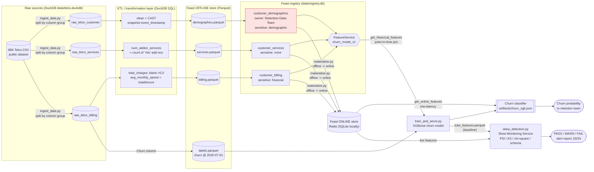

# Data lineage & provenance

Generated by `lineage.py` from the live Feast registry. Red node = feature view holding sensitive demographic attributes.

## Lineage dictionary

| Feature | Feature view | Source table | Source column(s) | Transformation logic | Owner | Sensitive tag | PII | Fairness audit |
|---|---|---|---|---|---|---|---|---|
| `gender` | customer_demographics | `raw_telco_customer` | `gender` | Copied as-is | Retention-Data-Team | demographic | none | required |
| `senior_citizen` | customer_demographics | `raw_telco_customer` | `SeniorCitizen` | CAST to BIGINT (0/1) | Retention-Data-Team | demographic | none | required |
| `partner` | customer_demographics | `raw_telco_customer` | `Partner` | Copied as-is | Retention-Data-Team | demographic | none | required |
| `dependents` | customer_demographics | `raw_telco_customer` | `Dependents` | Copied as-is | Retention-Data-Team | demographic | none | required |
| `phone_service` | customer_services | `raw_telco_services` | `PhoneService` | Copied as-is | Retention-Data-Team | none | none | not_required |
| `multiple_lines` | customer_services | `raw_telco_services` | `MultipleLines` | Copied as-is | Retention-Data-Team | none | none | not_required |
| `internet_service` | customer_services | `raw_telco_services` | `InternetService` | Copied as-is | Retention-Data-Team | none | none | not_required |
| `online_security` | customer_services | `raw_telco_services` | `OnlineSecurity` | Copied as-is | Retention-Data-Team | none | none | not_required |
| `online_backup` | customer_services | `raw_telco_services` | `OnlineBackup` | Copied as-is | Retention-Data-Team | none | none | not_required |
| `device_protection` | customer_services | `raw_telco_services` | `DeviceProtection` | Copied as-is | Retention-Data-Team | none | none | not_required |
| `tech_support` | customer_services | `raw_telco_services` | `TechSupport` | Copied as-is | Retention-Data-Team | none | none | not_required |
| `streaming_tv` | customer_services | `raw_telco_services` | `StreamingTV` | Copied as-is | Retention-Data-Team | none | none | not_required |
| `streaming_movies` | customer_services | `raw_telco_services` | `StreamingMovies` | Copied as-is | Retention-Data-Team | none | none | not_required |
| `num_addon_services` | customer_services | `raw_telco_services` | `OnlineSecurity`, `OnlineBackup`, `DeviceProtection`, `TechSupport`, `StreamingTV`, `StreamingMovies` | Sum of (col = 'Yes') over the six add-on columns -> 0..6 | Retention-Data-Team | none | none | not_required |
| `tenure` | customer_billing | `raw_telco_billing` | `tenure` | CAST to BIGINT | Retention-Data-Team | none | none | not_required |
| `contract` | customer_billing | `raw_telco_billing` | `Contract` | Copied as-is | Retention-Data-Team | none | none | not_required |
| `paperless_billing` | customer_billing | `raw_telco_billing` | `PaperlessBilling` | Copied as-is | Retention-Data-Team | none | none | not_required |
| `payment_method` | customer_billing | `raw_telco_billing` | `PaymentMethod` | Copied as-is | Retention-Data-Team | financial | none | proxy_check |
| `monthly_charges` | customer_billing | `raw_telco_billing` | `MonthlyCharges` | CAST to DOUBLE | Retention-Data-Team | financial | none | proxy_check |
| `total_charges` | customer_billing | `raw_telco_billing` | `TotalCharges` | TRIM -> NULLIF('') -> TRY_CAST DOUBLE -> COALESCE(0.0) (11 blank strings where tenure=0) | Retention-Data-Team | financial | none | proxy_check |
| `avg_monthly_spend` | customer_billing | `raw_telco_billing` | `TotalCharges`, `tenure`, `MonthlyCharges` | total_charges / tenure if tenure > 0 else monthly_charges | Retention-Data-Team | financial | none | proxy_check |

Machine-readable copy: `lineage_dictionary.json`.
